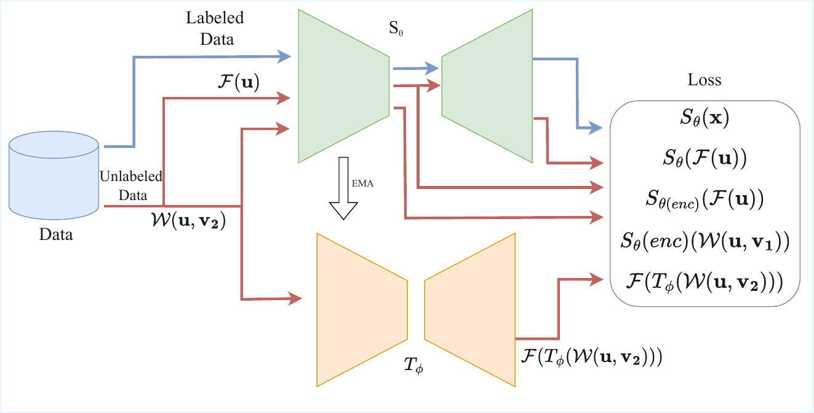
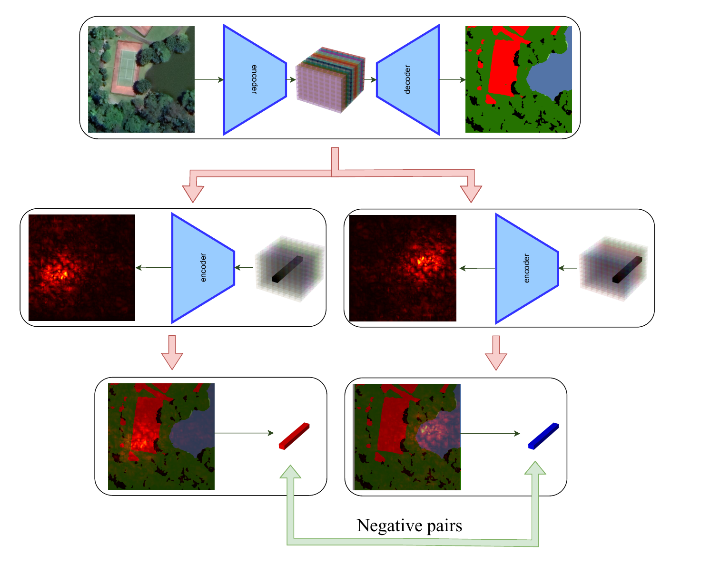

# Saliency-Based Contrastive Learning for Semi-Supervised Semantic Segmentation of Remote Sensing Images

## Overview

This repository contains the official implementation of a semi-supervised semantic segmentation framework based on **consistency regularization** and **saliency-guided contrastive learning** for remote sensing imagery.

The proposed approach leverages both labeled and unlabeled data through a teacher-student paradigm, combining consistency constraints with a contrastive objective that focuses on highly informative regions identified through saliency analysis. The method was designed for land use and land cover mapping in environmentally protected areas using high-resolution aerial imagery.

<p align="center">
  
</p>

<p align="center">
  
</p>

<p align="center">
  Overview of the proposed semi-supervised framework and negative sampling strategy.
</p>

## Main Features

- Semi-supervised semantic segmentation
- Teacher-student training framework
- Consistency regularization on unlabeled samples
- Saliency-based contrastive learning
- Support for cross-validation experiments
- Sliding-window inference for large remote sensing images
- U-Net backbone implementation
- Reproducible experimental setup through YAML configuration files

---

## Dataset

Experiments were conducted on a remote sensing dataset from the Environmental Protection Area of APA-Petrópolis (Rio de Janeiro, Brazil), containing manually annotated land use and land cover classes. The dataset is publicly available at:

### Classes

| ID | Class |
|----|--------|
| 0 | Urban |
| 1 | Forest |
| 2 | Shadow |
| 3 | Regeneration Forest |
| 4 | Agriculture |
| 5 | Rock Formation |
| 6 | Bare Soil |
| 7 | Water |

### Image Characteristics

- Original image size: 2048 × 2048 pixels
- Resized image size: 1024 × 1024 pixels
- Training patch size: 128 × 128 pixels

---

## Method

The proposed framework combines three learning objectives:

### Supervised Learning

A standard cross-entropy segmentation loss is applied to labeled samples.

### Consistency Regularization

The student network is encouraged to produce predictions consistent with the teacher network under perturbations applied to unlabeled images.

### Saliency-Based Contrastive Learning

A contrastive objective is computed using highly informative regions selected through saliency analysis. Salient pixels are extracted from feature representations and used to construct positive and negative pairs for representation learning.

### Main Hyperparameters

| Parameter | Value |
|------------|--------|
| Consistency Weight | 1.0 |
| Contrastive Weight | 0.1 |
| Noise Intensity | 0.2 |
| Top-K Salient Pixels | 1800 |
| Confidence Threshold | 0.603 |
| Anchors per Image | 5 |
| Contrastive Vectors | 16 |

---

## Network Architecture

Currently supported architectures:

- U-Net
- LANet

Example configuration:

```yaml
model:
  name: unet
```

---

## Training Configuration

### Optimizer

```yaml
optimizer: SGD
learning_rate: 0.001
momentum: 0.9
weight_decay: 0.0005
```

### Learning Rate Scheduler

```yaml
type: multi-step
milestones: [25, 35, 45]
gamma: 0.1
```

### Training Parameters

```yaml
maximum_epochs: 100
batch_size_labeled: 16
batch_size_unlabeled: 16
early_stopping_patience: 30
```

---

## Cross Validation

The framework supports K-Fold Cross Validation.

Configuration used in the experiments:

```yaml
folds:
  - fold_0
  - fold_1
  - fold_2
  - fold_3
  - fold_4
```

A total of five folds are used to evaluate robustness and generalization performance.

## Dataset Organization

To use a different dataset, the data directory must follow the structure expected by the configuration file.

The dataset path is defined by the `root_dir` parameter in the YAML configuration file:

```yaml
root_dir: path/to/dataset
```

Inside this directory, the dataset must contain two folders:

```text
root_dir/
├── images/
└── labels/
```

The `images/` folder must contain the input remote sensing images, while the `labels/` folder must contain the corresponding segmentation masks.

The split files are defined by the `root_dir_txt` parameter:

```yaml
root_dir_txt: path/to/txt_files
```

This directory must contain the text files that define which images and labels are used for training and testing:

```text
root_dir_txt/
├── train_images.txt
├── train_labels.txt
├── test_images.txt
├── test_labels.txt
└── split/
```

Each `.txt` file must contain one file path or file name per line.

The `split/` directory contains the semi-supervised splits used in the experiments. For example, for the 50% labeled setting, the structure must be:

```text
root_dir_txt/
└── split/
    └── 50/
        ├── train_images.txt
        ├── train_labels.txt
        ├── train_unlabeled_images.txt
        └── k_folds/
```

In this case:

- `train_images.txt` contains the images used for supervised training.
- `train_labels.txt` contains the labels used for supervised training.
- `train_unlabeled_images.txt` contains the images used for unsupervised training.

If cross-validation is enabled, the selected split folder must also contain a `k_folds/` directory:

```text
root_dir_txt/
└── split/
    └── 50/
        └── k_folds/
            ├── fold_0/
            │   ├── images.txt
            │   └── labels.txt
            ├── fold_1/
            │   ├── images.txt
            │   └── labels.txt
            ├── fold_2/
            │   ├── images.txt
            │   └── labels.txt
            ├── fold_3/
            │   ├── images.txt
            │   └── labels.txt
            └── fold_4/
                ├── images.txt
                └── labels.txt
```

Each fold directory contains the image and label lists associated with that fold. During cross-validation, one fold is used as the validation set, while the remaining folds are used for supervised training.

Therefore, for the code to run correctly, the expected directory structure is:

```text
root_dir/
├── images/
└── labels/

root_dir_txt/
├── train_images.txt
├── train_labels.txt
├── test_images.txt
├── test_labels.txt
└── split/
    └── 50/
        ├── train_images.txt
        ├── train_labels.txt
        ├── train_unlabeled_images.txt
        └── k_folds/
            ├── fold_0/
            │   ├── images.txt
            │   └── labels.txt
            ├── fold_1/
            │   ├── images.txt
            │   └── labels.txt
            ├── fold_2/
            │   ├── images.txt
            │   └── labels.txt
            ├── fold_3/
            │   ├── images.txt
            │   └── labels.txt
            └── fold_4/
                ├── images.txt
                └── labels.txt
```

To use another labeled-data proportion, change the `split` parameter in the YAML file and create the corresponding folder inside `root_dir_txt/split/`.

For example:

```yaml
split: "25"
```

requires the following directory:

```text
root_dir_txt/
└── split/
    └── 25/
```

---

## Inference

Large remote sensing images are processed using a sliding-window strategy.

```yaml
window_size: [128, 128]
test_stride: 32
batch_test: 57
```

This strategy enables efficient inference on high-resolution scenes while maintaining manageable GPU memory usage.

---

## Repository Structure

```text
.
├── configs/
├── data/
├── datasets/
├── losses/
├── models/
├── training/
├── inference/
├── utils/
├── results/
└── README.md
```

---

## Installation

Clone the repository:

```bash
git clone https://github.com/your-username/saliency-based-contrastive-learning.git

cd saliency-based-contrastive-learning
```

Create a virtual environment:

```bash
python -m venv .venv

source .venv/bin/activate
```

Install dependencies:

```bash
pip install -r requirements.txt
```

---

## Training

Run training with:

```bash
python main.py --config params.yaml
```

Results will be stored in:

```text
results/
```

---

## Citation

If you use this repository in your research, please cite:

```bibtex
@article{yourpaper2026,
  title={Saliency-Based Contrastive Learning for Semi-Supervised Semantic Segmentation of Remote Sensing Images},
  author={Author Names},
  journal={Journal or Conference},
  year={2026}
}
```

---

## License

This project is released under the MIT License.

---

## Acknowledgements

This work was developed for land use and land cover mapping in environmentally protected areas using remote sensing imagery. We thank all collaborators and institutions involved in data preparation, annotation, and experimental evaluation.
